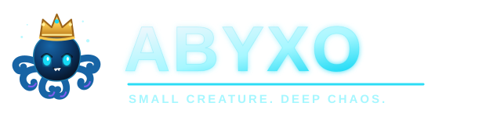

<!-- ABYXO project README -->

<div align="center">

  

  # ABYXO

  **Small Creature. Deep Chaos.**

  A deep-sea meme universe led by a crowned octopus, internet culture, and the Abyxonaut community.

  [](https://abyxo.xyz/)
  [](https://solana.com/)
  [](https://pages.cloudflare.com/)

</div>

---

## About ABYXO

ABYXO is a community-driven meme coin project concept built around a small, mischievous abyss-blue octopus with glowing cyan eyes and a permanent golden crown.

Its world blends deep-sea fiction, retro-inspired digital visuals, interactive browser experiences, and internet culture. The community is known as the **Abyxonauts**.

> Small Creature. Deep Chaos.

## Current project direction

- **Network direction:** Solana is the planned ecosystem for ABYXO.
- **Token status:** The official Solana contract address, ticker, and launch details have not been announced on the website. Treat unofficial token claims and contract addresses as unverified.
- **Website experience:** A multi-page static website with a **Retro Deep-Sea Hybrid** visual direction.
- **Hosting:** Cloudflare Pages.
- **Source of truth:** This GitHub repository.

Solana is a planned ecosystem direction; this README does not claim that a token or smart contract is already deployed.

## Explore the website

| Section | What you'll find |
| --- | --- |
| [Home](https://abyxo.xyz/) | Project introduction, Solana direction, and current launch-status information. |
| [The Lore](https://abyxo.xyz/lore.html) | ABYXO's origin, world, and deep-sea story. |
| [The Signal](https://abyxo.xyz/signal.html) | Project transmissions and updates. |
| [Community](https://abyxo.xyz/community.html) | Abyxonaut principles, community information, and safety guidance. |
| [ABYXO Arcade](https://abyxo.xyz/arcade.html) | Browser game: collect treasure, avoid hazards, progress through levels, and face bosses. Includes touch controls and a leaderboard interface. |
| [Deep Terminal](https://abyxo.xyz/terminal.html) | A character-driven local chat simulation and interactive terminal experience. |

Legal and information pages:

- [Disclaimer](https://abyxo.xyz/disclaimer.html)
- [Privacy](https://abyxo.xyz/privacy.html)
- [Terms](https://abyxo.xyz/terms.html)
- [Risk Disclosure](https://abyxo.xyz/risk-disclosure.html)

## Website features

- Responsive desktop and mobile layouts.
- Retro Deep-Sea Hybrid styling with dark ocean tones, neon accents, and retro interface details.
- ABYXO mascot, custom brand artwork, and Solana visual references.
- Multi-page navigation and project lore.
- Interactive terminal with selectable themes and backgrounds.
- **ABYXO Arcade:** a 100-level treasure run with five health points, hazards, boss encounters every ten levels, and an automatically firing tentacle weapon.
- Touch-and-drag game controls, sound toggle, and fullscreen mode.
- Optional Supabase-powered account and global leaderboard integration. Shared leaderboard functionality depends on valid Supabase configuration.
- Website audio controls and motion-conscious interface behavior.

## Technology

| Area | Technology |
| --- | --- |
| Markup | HTML5 |
| Styling | CSS3 |
| Interactions and game | Vanilla JavaScript |
| Arcade rendering | HTML Canvas |
| Optional leaderboard backend | Supabase |
| Hosting and deployment | Cloudflare Pages |
| Source control | GitHub |

The production website is a static site. The current `website/` structure does not require a frontend framework or build command.

## Repository layout

```text
Abyxo/
├── website/
│   ├── index.html
│   ├── lore.html
│   ├── signal.html
│   ├── community.html
│   ├── arcade.html
│   ├── terminal.html
│   ├── disclaimer.html
│   ├── privacy.html
│   ├── terms.html
│   ├── risk-disclosure.html
│   ├── styles.css
│   ├── script.js
│   ├── leaderboard.js
│   ├── site-sound.js
│   └── supabase/
├── assets/
├── community/
├── contracts/
├── docs/
├── supabase/
└── README.md
```

The `website/` directory contains the live site. Other top-level folders hold supporting project materials and documentation; their contents may evolve as the project develops.

## Run locally

You can preview the static website with Python's built-in HTTP server.

```bash
git clone https://github.com/musclank/Abyxo.git
cd Abyxo
python -m http.server 8000
```

Open:

```text
http://localhost:8000/website/
```

Using a local HTTP server is recommended for testing browser features, navigation, audio, and game behavior.

## Deployment

The production site is deployed with **Cloudflare Pages**, using this GitHub repository as its source.

Expected Pages configuration:

| Setting | Value |
| --- | --- |
| Production branch | The repository's connected production branch |
| Root directory | `website` |
| Build command | None |
| Build output directory | `.` |

Push website changes to the connected branch to trigger a Cloudflare Pages deployment. Check the Cloudflare Pages deployment history to confirm that the latest deployment completed successfully.

- Live website: [https://abyxo.xyz](https://abyxo.xyz)
- Repository: [https://github.com/musclank/Abyxo](https://github.com/musclank/Abyxo)

## Optional leaderboard setup

The Arcade includes a Supabase integration for player accounts and shared score rankings. Leaderboard availability depends on the project being configured correctly.

Before enabling it:

1. Create a Supabase project.
2. Review the SQL schema and setup instructions in the `website/` directory.
3. Configure the website's Supabase project URL and public client key.
4. Configure the allowed authentication URLs in Supabase.
5. Test account creation, sign-in, score submission, and sign-out before announcing the leaderboard as operational.

Never put a Supabase `service_role` key, database password, private key, or other server secret in browser-accessible code or commit it to Git.

## Transparency and safety

- ABYXO's website currently describes a project concept and community experience.
- Solana is the planned ecosystem; do not treat this as confirmation of a live token or deployed contract.
- No official contract address, ticker, launch date, audit, or market data should be assumed unless announced through verified ABYXO channels.
- Beware of impersonators, unofficial tokens, fake support accounts, and unsolicited direct messages.
- Nothing on the website or in this repository is financial or investment advice. Meme coins and digital assets can be highly volatile.

Always verify project information through the official website and linked ABYXO channels. Read the [Disclaimer](https://abyxo.xyz/disclaimer.html) and [Risk Disclosure](https://abyxo.xyz/risk-disclosure.html) before interacting with any related digital asset.

## Contributing

Suggestions, bug reports, and focused improvements are welcome. Please:

- Preserve existing pages, navigation, and working features unless a change explicitly requires otherwise.
- Test changes on both mobile and desktop.
- Avoid introducing unnecessary build tooling or backend dependencies to the static website.
- Never commit credentials, private keys, or personal information.

## Community

The ABYXO community is known as the **Abyxonauts**.

Follow the official project account on [X](https://x.com/itsabyxo) and use links published on [abyxo.xyz](https://abyxo.xyz/) to avoid impersonators.

---

<div align="center">

  **ABYXO — Small Creature. Deep Chaos.**

  Made for the depths. Powered by community.

  [Website](https://abyxo.xyz/) · [GitHub](https://github.com/musclank/Abyxo) · [X](https://x.com/itsabyxo)

</div>
