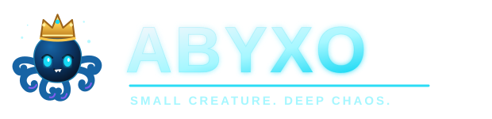
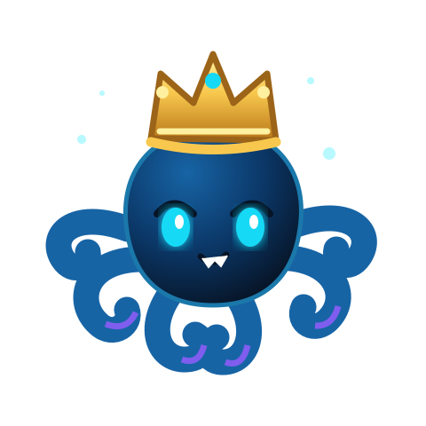

# ABYXO Media Kit

> **SMALL CREATURE. DEEP CHAOS.**

A compact reference for using ABYXO's current visual identity and introducing the project consistently.

## 1. Brand at a glance

- **Brand:** ABYXO
- **Tagline:** Small Creature. Deep Chaos.
- **Community name:** Abyxonauts
- **Ecosystem theme:** Base
- **Personality:** playful, mischievous, curious, internet-native, community-led
- **Core idea:** a tiny crowned octopus from the abyss, bringing harmless chaos and memorable memes to the timeline.

ABYXO is currently an early-stage meme coin concept. Do not imply that a token is live, deployed, audited, listed, or available to buy unless those facts have been independently confirmed and officially published.

## 2. Official visual assets

Use the repository assets below as the source of truth. Prefer SVG for crisp scaling.

| Asset | File | Recommended use |
|---|---|---|
| Primary logo | [logo.svg](../website/logo.svg) | Website headers, banners, presentations |
| Mascot | [mascot.svg](../website/mascot.svg) | Avatars, illustrations, community graphics |
| Favicon | [favicon.svg](../website/favicon.svg) | Browser and app icon |

### Preview

### Asset handling

- Keep the mascot's dark-blue body, glowing cyan eyes, mischievous expression, and gold crown.
- Do not remove, recolor, distort, stretch, or crop the crown or eyes.
- Keep the logo's proportions; scale it uniformly.
- Use the navy background for strong contrast when the artwork needs a dark canvas.
- Leave clear space around the logo approximately equal to the height of the mascot's crown.
- Do not add unofficial token tickers, contract addresses, exchange logos, or partner marks.

## 3. Color palette

| Color | Hex | Role |
|---|---|---|
| Abyss Navy | `#071426` | Primary background |
| Deep Panel | `#0C2038` | Cards and panels |
| Electric Cyan | `#16D9F5` | Primary accent, links, highlights |
| Ghost Aqua | `#A6F7FF` | Secondary highlight |
| Ocean Blue | `#1764A5` | Mascot and supporting graphics |
| Chaos Purple | `#8B5CF6` | Secondary accent |
| Sea Foam | `#F4F7FC` | Main text |
| Muted Current | `#9CB1C7` | Supporting text |
| Crown Gold | `#F8C84E` | Crown and important small accents |

## 4. Typography

- **Display and body:** Space Grotesk
- **Labels, technical details, and small captions:** DM Mono
- Use bold, compact display headlines for campaign graphics.
- Keep supporting copy short and readable.
- If the fonts are unavailable, use a clean geometric sans-serif for the main type and a monospaced fallback for labels.

## 5. Voice and writing

**Sound like:** a playful deep-sea signal, a clever meme account, and a welcoming community.

**Do:**
- Keep lines short, punchy, and easy to share.
- Use ocean, abyss, signal, tentacle, and crown imagery.
- Invite people to create, remix, and participate.
- Make jokes without promising financial outcomes.

**Avoid:**
- Guaranteed profit, price predictions, or investment promises.
- Fake urgency, fabricated partnerships, or invented milestones.
- Presenting fictional lore as factual project history.
- Calling an unconfirmed account, token, or contract official.

## 6. Ready-to-use copy

### Short bio
ABYXO 🐙👑 — Small Creature. Deep Chaos. A crowned little troublemaker from the deep, building a meme-loving crew on Base. Join the Abyxonauts.

### One-line introduction
Meet ABYXO: eight arms, one permanent crown, and absolutely no chill.

### Social post
A signal from the deep has been detected. 🐙👑

Small creature. Deep chaos.

The Abyxonauts are just getting started.

### Community call
Bring your memes. Keep your wits. Make some harmless chaos with the Abyxonauts.

### Hashtags
Use selectively: `#ABYXO` `#Abyxonauts` `#Base` `#MemeCoin`

## 7. Suggested graphic formats

These are working design suggestions, not pre-exported assets:

- **Profile avatar:** square 1:1, mascot centered with breathing room.
- **Social announcement:** 1:1 or 4:5, one headline and one clear message.
- **Wide banner:** 16:9, logo on one side and a short tagline on the other.
- **Community header:** wide landscape, mascot and “Abyxonauts” title.

Use the official SVG assets and palette above when creating these graphics.

## 8. Official links and verification

- **Website:** https://musclank.github.io/Abyxo/
- **Source repository:** https://github.com/musclank/Abyxo
- **Network theme:** Base
- **Telegram / X:** not yet confirmed for publication
- **Token ticker / contract:** not finalized / no verified address published

Only treat links published on the official website or repository as official. Never request or share anyone's seed phrase or private key.

## 9. Important notice

ABYXO is an early-stage meme coin concept and this media kit is a brand reference, not an offer, solicitation, or financial advice. Token details, launch plans, utility, and official community accounts may change and must be verified from official project channels.
